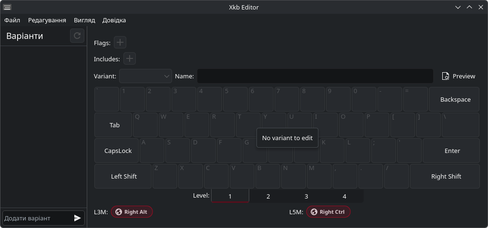
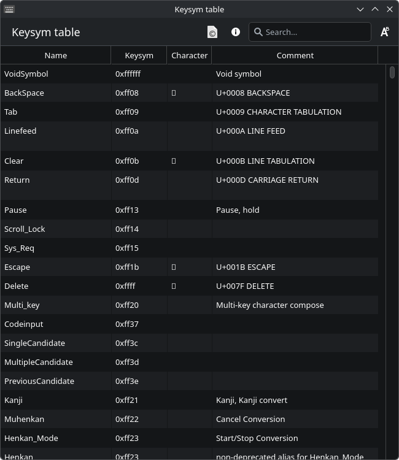
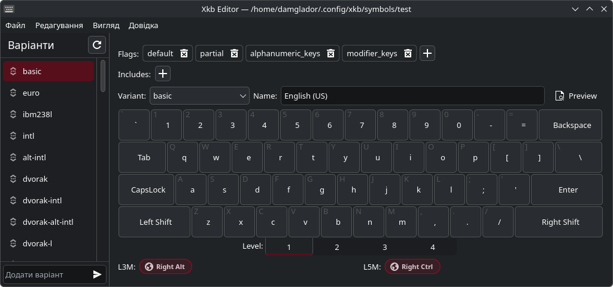
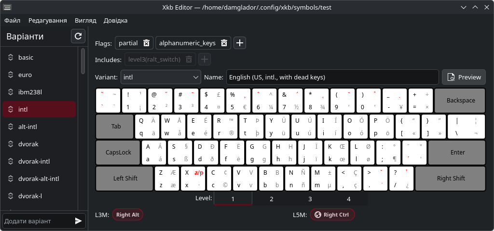

# Description

An editor for xkb files, which define keyboard layouts on Linux for X11 and Wayland compositors.

Features:
- Edit xkb_symbol entries in xkb files (variants)
- Edit includes and flags of variants
- Edit symbols for each key on standard US keyboard
- Rename, delete, add or re-arrange variants in a file
- UNDO EVERYTHING! (Took some time to implement)
- Preview complete layout
- Import variants from other files into your own

Planed:
- Editing/generating xkb registry config to add new layouts to GUI selectors (like Plasma Settings)

Check out [screenshots](README#Screenshots)

# Install

## Arch

```
yay -S xkb-editor
```

## Other

Grab AppImage from https://github.com/Damglador/xkb-editor/releases, should run even on Alpine.

# Dependencies

- kirigami (The KDE QML module, consequently all QML stuff)
- kitemmodels
- python
- pyside6
- python-lark
- python-pydantic
- libxkbcommon

# Run

```
git clone https://github.com/Damglador/xkb-editor
cd xkb-editor
pythom -m xkbeditor
```

# Screenshots








